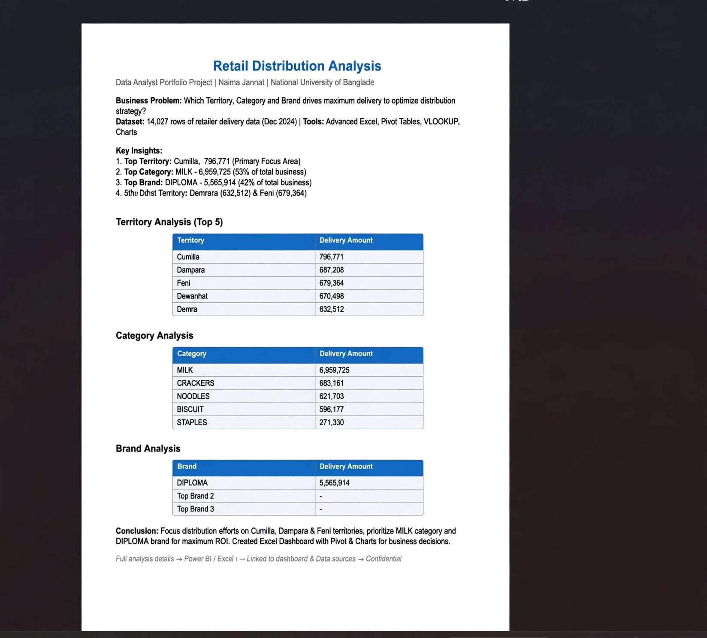

# Retail Distribution Analysis

Excel analysis of 14,027 rows of dealer delivery data (Dec 2024) to find which territory, category and brand drive the most delivery, and to support distribution strategy.

## Tools
Advanced Excel, PivotTable, VLOOKUP, INDEX-MATCH, Charts

## Key Findings
- Top territory: Cumilla (796,771)
- Top category: MILK (6,959,725), about 74% of business
- Top brand: DIPLOMA (5,565,914)
- 2nd and 3rd territories: Dampara and Feni

## Preview

### Summary Report

### Excel Analysis (PivotTables)

